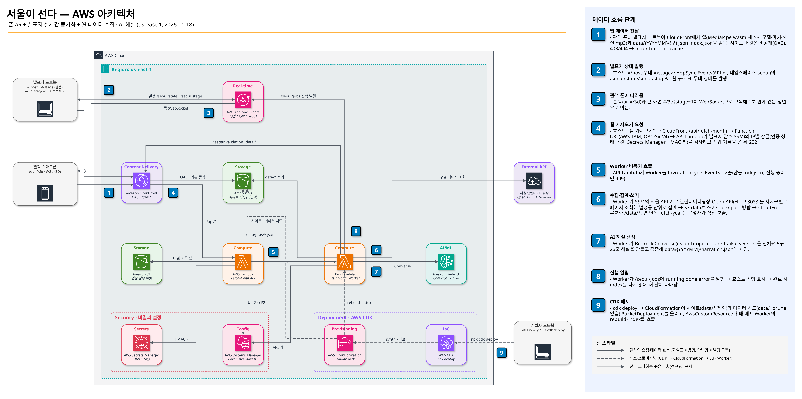
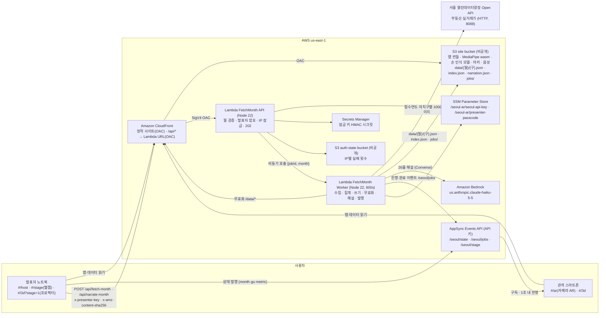
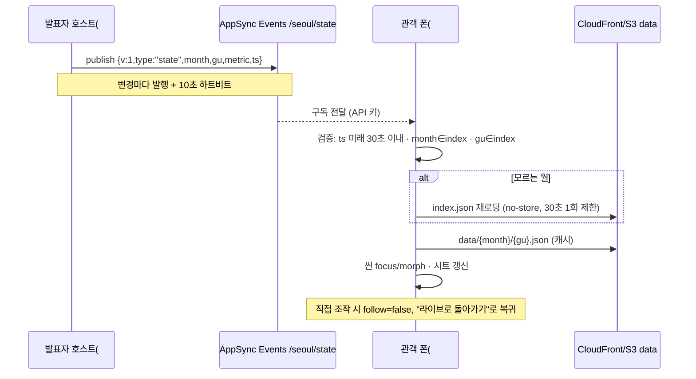
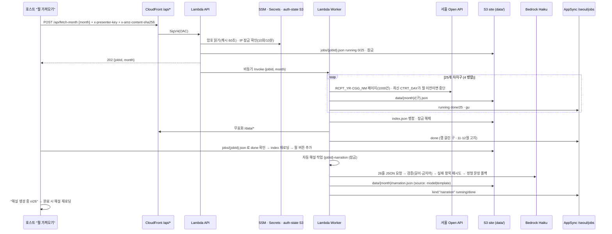
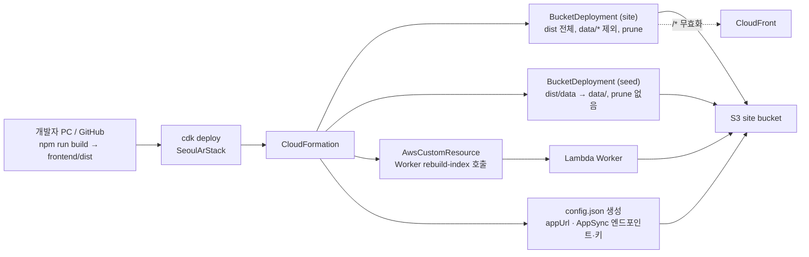
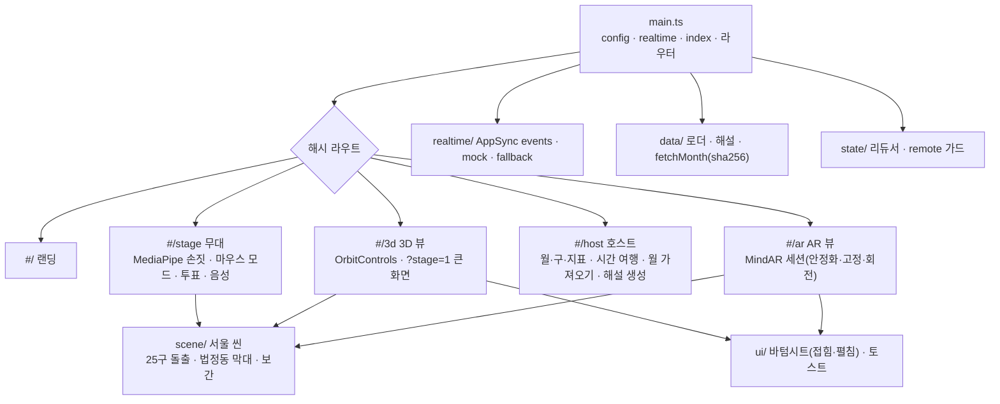

# 서울이 선다 — 아키텍처

GitHub에서 바로 보이는 Mermaid 그림으로 전체 구조, AWS 서비스 사용, 실시간 동기화, 월 수집·해설 파이프라인, 배포 흐름, 보안 경계를 정리했습니다. 공식 AWS 아이콘으로 그린 레퍼런스 아키텍처 그림은 아래 PNG와 편집용 `docs/seoul-ar-aws-architecture.drawio`(draw.io 또는 app.diagrams.net 에서 열기)입니다.

 세부 계약은 `docs/CONTRACTS.md`, 배포 절차는 `docs/SETUP-AWS.md`.

## 1. 전체 구조

## 2. AWS 서비스별 역할

| 서비스 | 역할 | 설정 요점 |
|---|---|---|
| Amazon CloudFront | 유일한 공개 진입점. 정적 사이트와 `/api/*` 두 동작 | S3·Lambda URL 모두 OAC, 403/404 → index.html, HTTPS 강제, HTTP/2·3 |
| Amazon S3 (site) | 앱 번들, 데이터 JSON, 해설, 작업 기록 저장 | 퍼블릭 차단, SSE-S3, 모든 객체 `Cache-Control: no-cache` |
| AWS AppSync Events | 발표자 → 관객 실시간 채널, 작업 진행 채널, 무대 채널 | API 키 인증(90일), 네임스페이스 `seoul` |
| AWS Lambda (API) | 암호·잠금 검사 후 작업 시작 | Function URL AWS_IAM + CloudFront OAC, 15초, 256MB |
| AWS Lambda (Worker) | 서울 API 수집·집계, S3 쓰기, 무효화, Bedrock 해설, 이벤트 발행, 연 단위 수집, index 재구성 | 600초, 512MB, 구 4개 병렬, 데드라인 가드 |
| Amazon Bedrock | 월·구별 한 줄 해설 생성 | 인퍼런스 프로파일 `us.anthropic.claude-haiku-5-5`, 작업당 호출 ≤ 30 |
| SSM Parameter Store | 서울 API 키, 발표자 암호 | SecureString, 사용자가 직접 생성, 코드·저장소에 값 없음 |
| AWS Secrets Manager | IP 잠금 기록 키용 랜덤 시크릿 | CDK가 생성, API Lambda만 읽기 |
| Amazon S3 (auth-state) | 암호 실패 횟수(IP 해시별) | 비공개, 1일 만료, ETag 조건부 쓰기로 원자적 증가 |
| AWS CDK / CloudFormation | 위 전부를 스택 하나로 배포 | 사이트·데이터 시드 두 BucketDeployment, 배포마다 `rebuild-index` 호출 |

## 3. 실시간 동기화 (발표자 → 관객)

## 4. 월 수집과 AI 해설 파이프라인

연 단위 수집(`fetch-year`)은 운영자가 Worker를 직접 호출하며, 구마다 접수연도 전체를 한 번 넘겨 계약월별로 나눠 저장합니다(월 단위보다 API 호출 1/6).

## 5. 배포 흐름 (CDK)

배포가 Lambda가 써 둔 달을 지우지 않게 사이트 동기화는 `data/*`를 건드리지 않고, 시드는 덮어쓰기만 하며, 배포 직후 S3에 있는 모든 달로 index를 다시 짭니다.

## 6. 보안 경계

| 경계 | 통제 | 알려진 제약 |
|---|---|---|
| 공개 인터넷 → CloudFront | HTTPS만, OAC로 S3·Lambda 직접 접근 차단 | — |
| 브라우저 → AppSync | API 키(설계상 공개, `config.json`) | 키로 발행도 가능해 주소를 아는 사람이 발표자 상태를 바꿀 수 있음. 폰은 ts·month·gu 검증과 작업 기록 확인으로 위조 영향 축소. 발행 잠금(Lambda 권한 부여자)은 미구현 |
| 호스트 → `/api/*` | 발표자 암호(12자 이상 강제), IP별 10회/10분 잠금(원자적), 본문 SHA-256 헤더, 코드별 한국어 사유 응답 | 공유 Wi-Fi에서는 관객이 발표자 IP를 잠글 수 있음(핫스팟 권고) |
| Worker → 서울 Open API | 키는 SSM에만, 로그·오류 메시지에 URL·키 미포함 | API가 HTTPS 미제공(평문 전송). 전용 키 사용·행사 뒤 폐기 |
| Worker → Bedrock | IAM을 프로파일·모델 ARN으로 한정, 작업당 호출 상한 | — |
| 데이터 | 법정동까지만, 본번·부번·건물명·행 단위 데이터 미포함(테스트로 강제) | — |
| 카메라·손 인식 | 브라우저 안에서만 처리, 외부 전송 없음, MediaPipe 통계 송신 코드 빌드 검사 | — |

## 7. 프론트엔드 구성

